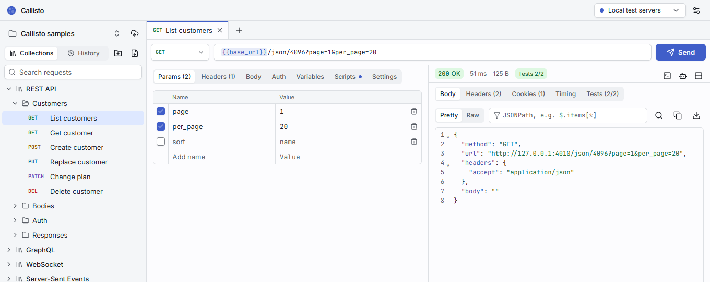
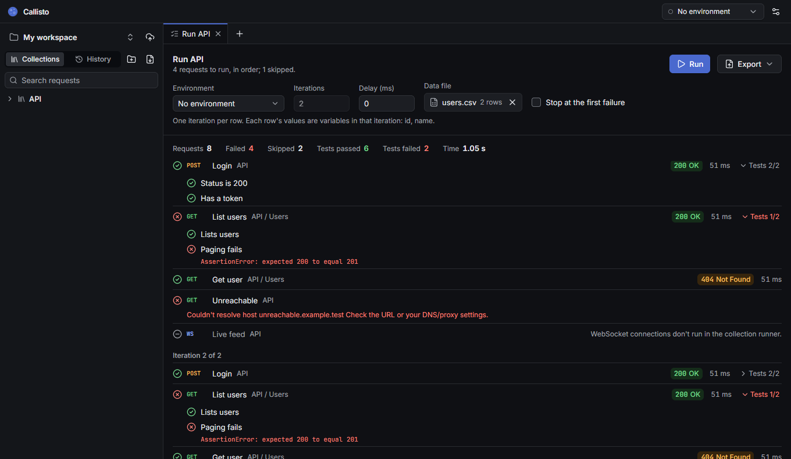
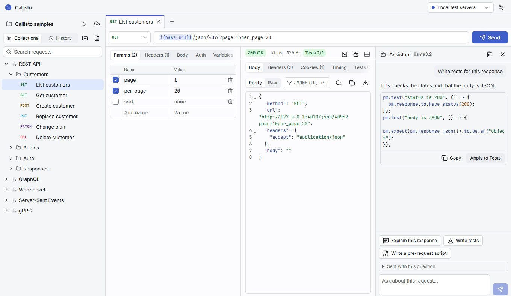

# Callisto

Callisto is an offline-first desktop API client. Send a request, inspect its response, and save it alongside the rest of your collection as plain YAML files. You can work without an account and share a workspace through Git.

**[Download the latest release](https://github.com/amitkhairnar44/callisto-releases/releases/latest)** · [Choose an installer](#download) · [Explore the features](#features)

## Download

**v0.4.1** includes security updates and a clearer startup message if Callisto cannot open its database. [Read the release notes](https://github.com/amitkhairnar44/callisto-releases/releases/tag/v0.4.1).

Both editions are stable and can be installed side by side. **Callisto** includes a sandboxed HTML response preview. **Callisto Native**, formerly Callisto Preview, uses a native interface and displays HTML responses as source. Both open the same workspace format and keep separate histories, settings, and secret stores. Callisto Native keeps your existing Preview data.

| Platform | Callisto | Callisto Native |
| --- | --- | --- |
| macOS · Apple silicon | [DMG](https://github.com/amitkhairnar44/callisto-releases/releases/download/v0.4.1/Callisto_0.4.1_aarch64.dmg) | [DMG](https://github.com/amitkhairnar44/callisto-releases/releases/download/v0.4.1/Callisto-Native_0.4.1_aarch64.dmg) |
| macOS · Intel | [DMG](https://github.com/amitkhairnar44/callisto-releases/releases/download/v0.4.1/Callisto_0.4.1_x64.dmg) | [DMG](https://github.com/amitkhairnar44/callisto-releases/releases/download/v0.4.1/Callisto-Native_0.4.1_x64.dmg) |
| Windows · x64 | [Setup](https://github.com/amitkhairnar44/callisto-releases/releases/download/v0.4.1/Callisto_0.4.1_x64-setup.exe) · [MSI](https://github.com/amitkhairnar44/callisto-releases/releases/download/v0.4.1/Callisto_0.4.1_x64_en-US.msi) | [Setup](https://github.com/amitkhairnar44/callisto-releases/releases/download/v0.4.1/Callisto-Native_0.4.1_x64-setup.exe) · [Portable ZIP](https://github.com/amitkhairnar44/callisto-releases/releases/download/v0.4.1/Callisto-Native_0.4.1_x64.zip) |
| Linux · x86-64 | [AppImage](https://github.com/amitkhairnar44/callisto-releases/releases/download/v0.4.1/Callisto_0.4.1_amd64.AppImage) · [DEB](https://github.com/amitkhairnar44/callisto-releases/releases/download/v0.4.1/Callisto_0.4.1_amd64.deb) · [RPM](https://github.com/amitkhairnar44/callisto-releases/releases/download/v0.4.1/Callisto-0.4.1-1.x86_64.rpm) | [Tarball](https://github.com/amitkhairnar44/callisto-releases/releases/download/v0.4.1/Callisto-Native_0.4.1_x86_64.tar.gz) · [DEB](https://github.com/amitkhairnar44/callisto-releases/releases/download/v0.4.1/Callisto-Native_0.4.1_amd64.deb) · [RPM](https://github.com/amitkhairnar44/callisto-releases/releases/download/v0.4.1/Callisto-Native-0.4.1-1.x86_64.rpm) |

On macOS, the apps are not notarized. After the first launch attempt, you can allow the app in **System Settings → Privacy & Security**. On Windows, SmartScreen may prompt you to select **More info → Run anyway**. You can verify a download against the release’s [SHA-256 checksums](https://github.com/amitkhairnar44/callisto-releases/releases/download/v0.4.1/SHA256SUMS.txt).

## Features

### Send requests and inspect responses

| Protocol | What you can do |
| --- | --- |
| **HTTP** | Send JSON, forms, multipart uploads, or binary files. Inspect headers, cookies, redirects, and timing. Filter a JSON response with JSONPath. |
| **GraphQL** | Explore a schema, autocomplete fields, run queries and mutations with variables, and follow subscriptions over WebSocket. |
| **WebSocket** | Send text, JSON, or binary messages. Save messages for reuse and filter the connection log. |
| **Server-Sent Events** | Open a GET or POST stream and read events as they arrive. |
| **gRPC** | Discover methods through server reflection or import proto files. Make unary and streaming calls with metadata, deadlines, and gzip. |

Set auth on a collection or folder and let requests inherit it. Switch environments to reuse a request with different hosts and credentials. Network settings include proxies, custom certificate authorities, and client certificates.

### Test a collection

Add JavaScript pre-request scripts and tests to a request, folder, or collection. The runner executes HTTP and GraphQL requests in order, repeats them for rows in a CSV or JSON file, and exports results as JSON or JUnit XML. Expand a result to see which assertion failed.

### Ask about a response

The optional assistant can explain the last response, draft tests and pre-request scripts, or write a GraphQL operation. Choose Ollama, LM Studio, an OpenAI-compatible server, or Anthropic in Settings. Review what goes with each question and choose **Apply** to put a suggestion in the editor as an unsaved change.

### Organize and share your work

- **Workspaces and Git.** Group requests into collections and folders. Open a workspace from Git, review conflicting copies, or use **Sync all** across your connected workspaces.
- **Import and export.** Bring in Postman, Insomnia, Hoppscotch, Thunder Client, OpenAPI, Swagger, HAR, or cURL. Preview the import, export a workspace as a ZIP, or copy a request as cURL.
- **History and navigation.** Reopen an earlier request from History, or find a request or action with the command palette (`Ctrl+K` on Windows and Linux, `⌘K` on macOS).
- **Secrets and privacy.** Secret values stay out of workspace files, history, and exports. The assistant asks for consent before sending context to a remote provider. Conversations stay on the device.

*Screenshots show the Callisto interface with sample requests and simulated responses.*

## Updates

Both apps ask at first launch whether to check for updates automatically. In-app installations verify the update signature. Callisto Native installations from a ZIP, DEB, or RPM direct you to the releases page for a new download.

This repository hosts installers and release notes. [Browse all releases](https://github.com/amitkhairnar44/callisto-releases/releases).
